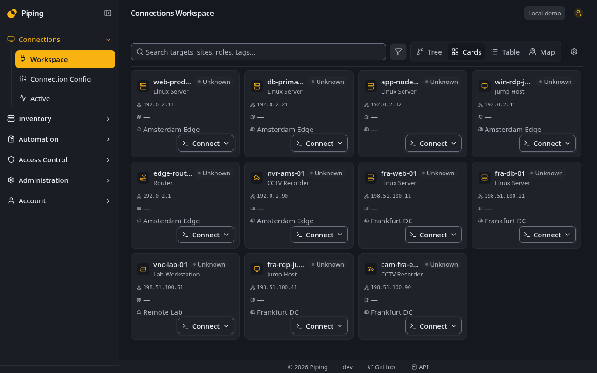

<div align="center">

# Piping

**Infrastructure context. Connections. Automation.**

Keep your inventory, open remote sessions and run Ansible playbooks in one self-hosted workspace.

**[piping.space](https://piping.space)** · [Install](#install) · [Contribute](CONTRIBUTING.md) · [License](LICENSE)

</div>



## From inventory to action

Infrastructure work rarely ends at a device record. Piping connects the inventory
to the next step: finding a target, inspecting its context, opening a browser
session or choosing the targets for an automation run.

### 🗂️ One inventory, several ways to explore

Keep devices, virtual machines, sites and IP addresses together. The **Connections
Workspace** gives you a tree, cards, a table and a geographic Map for finding
connection targets. A shared inspector keeps the selected target's details close
as you move between views.

Use the Map for geographic context, the tree for grouped navigation, or the
table when you need to scan a list. They are views of the same workspace, not
separate inventories to maintain.

### 🖥️ Connect from your browser

Open **SSH, RDP and VNC** sessions from inventory targets without switching to a
separate connection catalog. Keep the target's infrastructure context alongside
the connection workflow, with access governed by roles and policies.

### ⚙️ Put the inventory to work

- **Ansible automation:** run playbooks against inventory targets
- **NetBox integration:** bring supported inventory into Piping through mapped
  imports and synchronization
- **Monitoring discovery:** feed your monitoring system with inventory-driven,
  Prometheus-compatible **HTTP service discovery**

### 🤖 Context and explicit permissions for AI agents

Use **MCP and the API** to give agentic systems infrastructure context. Grant
inventory reads for a context-only workflow, or explicitly permit actions such
as SSH execution on selected connection targets.

Token scopes limit actions and resources; the underlying roles and policies
still apply. Scoped SSH actions run with the configured infrastructure identity
and are recorded in the audit log.

## Try the interface

The demo above shows the real frontend with synthetic public data. To explore it
locally without a backend or credentials, follow [Run the UI demo](CONTRIBUTING.md#run-the-ui-demo).
Demo changes reset on reload.

## Install

Requires Linux/amd64, Bash 4+, Docker with Compose v2, OpenSSL, Python 3.12+,
GNU coreutils (`realpath`) and util-linux (`flock` and `findmnt`). Your user must
be able to run Docker.

```sh
curl -fsSL https://raw.githubusercontent.com/mlimarenko/piping/1.0.0/install.sh | bash
```

The installer downloads the release and its public container images, installs
into `~/piping` and serves Piping at **https://localhost**. The initial self-signed
certificate needs browser trust; use a trusted certificate for a shared service.
Find the administrator password in the installation's private `.env` file.
Keep that file and the installation's data safe; rerunning the installer cannot
recover lost secrets.

Run `~/piping/install.sh --help` for hostname, port and image options.
Rerunning the installed script starts the configured stack; it does **not**
automatically upgrade images. Explicit image updates use the guarded backup and
migration flow. If an update fails, inspect its private backup and journal before
attempting recovery.

[Development and contributions](CONTRIBUTING.md) · [Desktop client](apps/desktop/README.md) · [License](LICENSE)
